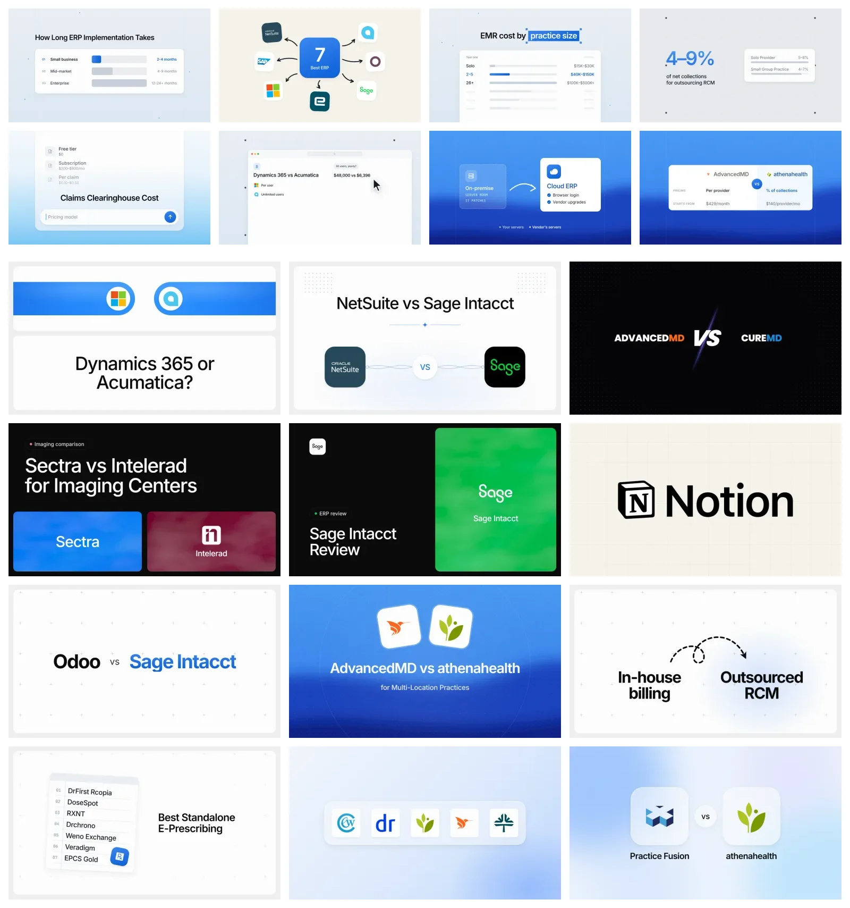

# Blog Featured Images: a Claude Code skill

Turn blog article URLs into **premium, article-specific featured images** (1600×900 plus crops) in two families: calm card layouts on grainy light backgrounds (plus a vibrant deep-blue field), and Chatbase-style headline layouts for comparisons (facing pills, connected logos, black slash, black + brand colour). It's free: everything renders with headless Chrome, with **no AI image generation**.



*The finalized reference set: card layouts (top) and headline layouts (bottom). The same images ship in `references/approved/`, and the renderer's defaults reproduce this look.*

Every image:
- **mirrors the blog title** and uses **only the article's own facts**
- is **minimal**: at most 15 words, labels not sentences (enforced)
- sits on a **background chosen to flatter its illustration** (enforced)
- **looks different** from every other image in the same category (enforced)
- shows **real, balanced product logos** where products are named
- is **checked by an independent QA agent**, with visual appeal as a hard gate

---

## Install

```bash
npx skills add https://github.com/wardiva/blog-skills --skill blog-featured-images
```

Add `-g` to install it for all your projects.

## One-time setup

| Need | Why | How |
|---|---|---|
| **Node 18+** and **Chrome or Edge** | Renders the images | Set the `CHROME` env var if Chrome isn't found automatically |
| `sharp` | Crops and exports | Run `npm install` in the skill's `scripts/` folder (Claude does this on first use) |
| **agent-browser** (recommended) | Reads every article URL in parallel, in seconds | `npm i -g agent-browser`. It uses your existing Chrome; without it, Claude falls back to WebFetch |
| **Brandfetch client ID** (optional) | Sharper official logos | Free at [brandfetch.com/developers](https://brandfetch.com/developers). Keep it **local**, never in a repo |

Save your Brandfetch client ID in `~/.blog-featured-images/config.json`:

```json
{ "brandfetchClientId": "YOUR_CLIENT_ID" }
```

or set the `BRANDFETCH_CLIENT_ID` env var. Without an ID, logos still work through the free Iconify and Simple Icons libraries.

## Use

In Claude Code:

> Make featured images for these articles: https://example.com/blog/post-1/ https://example.com/blog/post-2/

Or invoke `/blog-featured-images`. Each article gets a `featured-images/<slug>/` folder:

| File | Use |
|---|---|
| `master.png` | 1600×900 master |
| `16x9-1200.webp` | Social and OG image |
| `7x5.webp` | Theme crop |
| `card-350x250.png` | Thumbnail check |

---

## How it works

**Three agents, in one fast batch:**

1. **Orchestrator** (Claude): reads every URL at once (`read-articles.mjs`), picks the least-used layout per article and which ones go on the vibrant blue, and reserves them all (`plan.mjs`).
2. **Makers** (parallel subagents): write each spec from the article's facts and render it.
3. **QA** (an independent subagent): judges the whole batch on one contact sheet (`sheet.mjs`): visually appealing, background fits, no reused layout, 2-second scan, minimal text, balanced, true to the article, clean logos. Failures go back to their Maker; only images that pass are delivered.
4. **Finalize** (`finalize.mjs`): delivered images become permanent. They stay stored (plus a copy in `~/.blog-featured-images/delivered/`), keep counting for layout rotation, and can never be re-created or overwritten.

**Built-in checks** (the renderer refuses to finish):

| Check | Rule |
|---|---|
| `HEADING CHECK FAILED` | The image heading must reuse the blog title's own words |
| `TEXT CHECK FAILED` | At most 15 words per image and 7 per element (no sentences) |
| `VARIETY CHECK FAILED` | A layout can't repeat in a category until every layout has been used (history per site in `~/.blog-featured-images/history-<brand>.json`) |
| `BACKGROUND FIT FAILED` | Each layout only takes the light backgrounds that flatter its illustration |
| `BACKGROUND CHECK FAILED` | Only `sky`, `paper`, `cream`, `g5` and `blue` exist |
| `VIBRANT CHECK FAILED` | Vibrant images (the deep-dunes blue and the black layouts) appear on at most 1 in 3 images per category, never on neighbours |
| `LOGOTYPE CHECK FAILED` | `logotype` needs a black logo lockup; coloured logos use `dark` |
| `VIBRANT FIT FAILED` | Only checklist, versus/table, window and before-after/flow go on the vibrant blue |
| `SERIES CHECK FAILED` | The optional site mark appears on at most 1 in 3 images per category, never on neighbours |
| `FINAL IMAGE LOCKED` | A delivered image is permanent: it can't be re-created or overwritten |
| `CONTENT CHECK FAILED` | Each layout needs enough real facts to fill its frame |
| `FAIRNESS CHECK FAILED` | An X vs Y article always shows both products |

**The look:**
- **Backgrounds:** light `sky`, `paper`, `cream`, `g5`, each picked to flatter its illustration (e.g. a big blue tile gets a neutral field, grey bars get sky), plus the vibrant **"deep dunes" blue** on about 1 in 3 images, only behind a big white card.
- **Grain:** heavy on the blue, fine on `sky`, `paper` and `g5`; `cream` stays clean, with no grain.
- **Shadows follow the background:** none on the blue or black, minimal and tinted on light fields.
- **One bold blue anchor**, white UI cards, navy headlines, a hero at 55–70% of the width.
- **Logos:** a free chain (Brandfetch symbol → Iconify → Simple Icons → Brandfetch icon → letter tile), loaded at render time. Logos fill ~65% of their tile, app icons fill the tile, pale marks are darkened, and "best of" hubs show logos only. A wrong mark can be replaced by the official file in `featured-images/assets/`.

## Layouts (13 modes, 19 layouts)

**Card layouts:**

| Mode | Variants | Best for | On the vibrant blue |
|---|---|---|---|
| `before-after` | `default`, `flow` | How-to, migration, "old way → new way" | `flow` only |
| `versus` | `overlap`, `table` | X vs Y | `table` only |
| `hub` | default | "Best X" lists (6–7 product logos, logos only) | no |
| `focus` | default | One key idea with 2–3 values | no |
| `stat` | default | One headline number | no |
| `ranked` | default | Rankings by a real metric | no |
| `timeline` | default | Processes, implementation | no |
| `checklist` | default | How to choose, requirements | yes |
| `prompt` | default | Cost, pricing, FAQ | no |
| `stack` | default | One key rule | no |
| `window` | default | Vendor lists, pricing tables | yes |

**Headline layouts** (after Chatbase: subtle vivid blue shapes, white designs in a grey frame, two on black):

| Layout | Best for |
|---|---|
| `versus/pills` | X vs Y: two facing pills with the logos, the question below |
| `versus/connect` | X vs Y: two logo tiles linked to a VS circle (a favourite: may repeat up to 5 times per category) |
| `versus/slash` | X vs Y on black: bold names, italic VS (a favourite: may repeat up to 5 times per category) |
| `versus/duo` | X vs Y on black: two panels in each brand's colour with white logos (a favourite: may repeat up to 5 times per category) |
| `dark` | Single-product articles (review, pricing, features): the product's icon on a white tile top-left, its colour as the panel, white logo; up to 3 per category |
| `logotype` | Single-product articles with a black logo: icon on a black tile beside the wordmark, on cream with a faint grid; up to 2 per category |

## Add your own site

Copy `brands/_template.json` to `brands/<site>.json`, fill in the site's colours, and optionally `markUrl` (the site's own square icon) and `markName` for the site mark. Then set `"brand": "<site>"` in specs. Variety history is kept separately per brand.

## What's inside

| Path | Contents |
|---|---|
| `SKILL.md` | Hard rules, layouts and workflow (Claude reads this first) |
| `references/approved/` | The finalized reference images: the target look |
| `references/design-language.md` | The rulebook: visual appeal, backgrounds and fit, shadows, layouts, text budget, logos, guardrails |
| `references/spec-format.md` | The JSON spec for every layout (every snippet renders as-is) |
| `references/agents.md` | Three-agent flow, Maker and QA prompts, QA checklist |
| `references/lessons.md` | Speed tools, gotchas, pre-flight checks, taste |
| `scripts/` | `render.mjs` (renderer + checks), `layouts.mjs` (the layout list), `read-articles.mjs`, `plan.mjs`, `sheet.mjs`, `finalize.mjs` (locks delivered images) |
| `examples/` | Approved specs for every layout |

## Troubleshooting

| Problem | Fix |
|---|---|
| Chrome not found | Set `CHROME` to your Chrome or Edge executable |
| `TEXT CHECK FAILED` | Cut secondary lines first, then shorten phrases to labels |
| `VARIETY CHECK FAILED` | Use one of the listed layouts. Run `plan.mjs` to see usage; if every layout is used, add a variant |
| `BACKGROUND FIT FAILED` / `VIBRANT FIT FAILED` | Remove `bg` from the spec; the renderer picks the best background |
| Logos are broken or low-res | Add a Brandfetch client ID and check your connection (logos load at render time) |
| An article URL fails to load | The reader retries once; run it again or paste the article text |

Logos are trademarks of their owners and are shown to identify products in editorial content.
